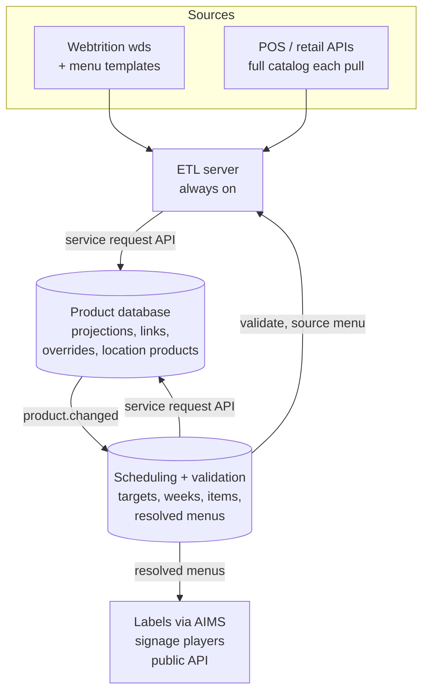

# Menu Scheduling Design

| | |
|---|---|
| **Status** | **Proposed — awaiting approval.** No build work starts until this is approved. |
| **Version** | 1.0 · 2026-11-25 |
| **Owner** | Eric Melgaard |
| **Scope** | Infrastructure, table schema and the logic that populates menu schedules on smart labels and signage menu zones |
| **Source of truth** | This file (`docs/MENU_SCHEDULING_DESIGN.md`). Any review page is a copy of it. Change this file first, add a row to the change log, then rebuild. |

**How to use this document.** Each part of the build should point back to a section here: the
tables in §5–7, the flows in §8 (`F1`–`F11`), the APIs in §9. Decisions have IDs (`D1`–`D23`, §11). If
code and this document disagree, this document wins until it's changed on purpose.

## 1. Goals and non-goals

**Goals**

- Schedule what each smart label and signage menu zone shows, by daypart, day and week, from a
  Default Week plus week overrides.
- Support two kinds of menu with one model:
  - **Webtrition menus**: scheduled at the site on a menu cycle (usually 4 weeks). Webtrition is the
    system of record for those items. WAND adds site and company enrichment, validates items against
    the day's menu, and places them in the right positions.
  - **Retail menus**: relatively static. The WAND product database is the system of record. Items are
    seeded at the concept and linked to any number of POS APIs.
- Keep every store working when a source (Webtrition, a POS) is down.
- Nothing slow in front of the UI.

**Non-goals**

- How attributes display on labels or signage (out of stock, badges, colors). Out of stock is just an
  attribute here.
- Rebuilding Webtrition's recipe, menu or cycle systems.
- The existing playground product tables. The product database can be built new.

## 2. Architecture

Three systems with separate responsibilities.



| System | Owns | Never does |
|---|---|---|
| **ETL server** | Every call to a source. Attribute maps. The Webtrition validation cache (this week and next). POS staging catalogs. Creating and refreshing projections. | Store schedules or local overrides |
| **Product database** | What an item *is*: projections, source links, harvested values, overrides at concept / company / store, and each store's always-available product set (`location_products`). Reached only through its **service request API**. | Know which day or target an item is on |
| **Scheduling + validation** | Where and when an item shows: targets, Default Week, weeks, placements, order locks, resolved menus. | Call a source directly, or store product attributes beyond a one-week override |

## 3. Infrastructure choices

| # | Choice | Why | Rejected |
|---|---|---|---|
| I1 | **Three separate systems** (ETL, product DB, scheduling) | The product database serves many APIs and locations beyond menus. Scheduling only places items. Source calls stay in one place. | One combined menu service: mixes the system of record with placement, and source outages leak into the UI |
| I2 | **ETL is an always-on service** answering direct calls. Background work runs on workers or a nightly job. | Rule: no slow DAGs in front of a UI. `validate` and `source-menu` are called while a person waits. | Airflow DAGs on the request path. Airflow is allowed only for the nightly batch. |
| I3 | **Validation cache in the ETL** for this week and next, one wds call per store per week (`Days=7`) | WAND's wds route never caches items (every call hits Compass), so this snapshot *is* the cache. Keeps a stale copy if Webtrition is down. | Calling wds per request. Keeping dated Webtrition items longer. |
| I4 | **Product database behind a service request API** | Many callers (scheduling, ETL, other apps). Lets the product DB change inside without breaking callers. | Shared tables joined directly by scheduling |
| I5 | **`location_products`: a resolved product set per store**, rebuilt on change | A store works when sources are down. Search, quick add and scheduling read one table. | Resolving through the source chain on every read |
| I6 | **Resolved menus cached** for this week and next, with a hash | Devices, signage, the AIMS push and the public API read only this. The hash decides whether to push. | Resolving on every device request |
| I7 | **Events, not polling**, between systems (`product.changed`) | Product and price changes reach menus right away without scans | Nightly reconciliation only |
| I8 | **Postgres** for all three. Playground: one Supabase project with schemas `product`, `etl`, `schedule`. | Matches today's stack. Schemas keep the boundaries real. | Separate databases in the playground |

**Where it runs**

| Piece | Production | Playground |
|---|---|---|
| ETL server | WAND service (always on) + workers | Supabase edge function (`populate-menu-data` grows into it) + `pg_cron` |
| Product database + service request API | WAND service on Postgres | `product` schema + RPC functions standing in for the API |
| Scheduling + validation | WAND service on Postgres | `schedule` schema + edge function |
| Events | Queue or webhook | Trigger + `pg_notify` |
| Nightly / rollover / retention | Scheduled job (Airflow allowed here) | `pg_cron` |

## 4. Concepts and identities

| Term | Meaning |
|---|---|
| **Projection** | A WAND product over one or more linked sources plus local overrides (the DoorDash / Grubhub model). Every item on a menu is a projection. |
| **Link** | A projection's connection to a source item, in priority order (1 = primary). |
| **Attribute map** | Per source type: which source field fills which WAND attribute. Changing POS means using another map, not changing products. |
| **Location products** | A store's full, resolved product set. Always available. |
| **Target** | Something that shows a menu: a smart label or a signage menu zone. |
| **Default Week** | A target's base week. Days of the week only, no dates. |
| **Week** | A target's schedule for one real week (Sunday to Saturday). It follows the Default Week until someone edits it. |
| **Validation cache** | Dated Webtrition menu items for this week and next, held by the ETL |
| **Staging catalog** | What a POS sends that no one has mapped yet |
| **Lab store** | A store a concept uses to set up and map POS catalogs |

| Thing | Identity | Lives in |
|---|---|---|
| Webtrition menu item (one day) | Webtrition `id`, unique per date × meal period × station | Validation cache only |
| Webtrition item across days | **Fingerprint** `(mrn, portion, meal_period)` | Matching at resolve time |
| Webtrition projection | `(company, mrn, portion)` | Product database |
| POS item | `(source_system, external_id)`; ids are **global across a concept** | Staging catalog, concept maps, links |
| Retail projection | `product_id`, owned by the concept | Product database |

- **Station is not part of the match.** People add an item from the right station. Station is saved for
  sorting and as a tie-break, never checked.
- **A different portion is a different item.** Edits apply to the same MRN + portion only.
- An MRN is a master recipe. A Webtrition menu item can differ from its recipe (name, price, portion).

## 5. Data model: product database

Postgres. All tables have `created_at` / `updated_at` unless shown otherwise.

### 5.1 Hierarchy

```sql
create table concepts (
  id          uuid primary key,
  name        text not null,
  settings    jsonb not null default '{}'   -- allow_location_brand_edits, allow_make_brand_item
);

create table companies (
  id    uuid primary key,
  name  text not null
);

create table company_concepts (              -- a company can run several concepts
  company_id  uuid references companies,
  concept_id  uuid references concepts,
  primary key (company_id, concept_id)
);

create table stores (
  id          uuid primary key,
  company_id  uuid not null references companies,
  name        text not null,
  timezone    text not null,
  sap_code    text, venue text,             -- Webtrition unit + location
  is_lab      boolean not null default false,  -- a lab store a concept maps from
  settings    jsonb not null default '{}'   -- openDays…
);
```

### 5.2 Projections and links

```sql
create table products (
  id           uuid primary key,
  kind         text not null check (kind in ('webtrition','retail','custom')),
  owner_level  text not null check (owner_level in ('concept','company')),
  owner_id     uuid not null,               -- concept for retail, company for webtrition / custom
  mrn          text, portion text,          -- webtrition only; portion '' when none
  name_key     text not null,               -- normalized name, for the name check
  status       text not null default 'active' check (status in ('active','inactive','retired')),
  first_seen   date, last_seen date,
  created_by   text not null,               -- 'etl', 'seed', or a user id
  check ((kind = 'retail') = (owner_level = 'concept'))
);
create unique index on products (owner_id, mrn, portion) where kind = 'webtrition';
create unique index on products (owner_id, name_key)     where kind <> 'webtrition';

create table source_attribute_maps (         -- one map per source type
  source_system  int  not null,
  source_field   text not null,
  attribute      text not null,             -- name, price, calories, allergens, out_of_stock…
  transform      text,                      -- optional: cents_to_dollars, code_to_icon…
  primary key (source_system, source_field)
);

create table product_links (
  id                 uuid primary key,
  product_id         uuid not null references products,
  priority           int  not null,         -- 1 = primary; API links use store_sources.priority when set
  target             text not null check (target in ('api','product')),
  source_system      int,
  external_id        text,                  -- POS item id, or 'mrn|portion' for Webtrition
  linked_product_id  uuid references products,  -- target 'product'
  scope_level        text check (scope_level in ('concept','company','store')),
  scope_id           uuid,
  linked_at          timestamptz not null,
  unlinked_at        timestamptz            -- closed on relink; history kept
);
create unique index on product_links (product_id, priority) where unlinked_at is null;
create unique index on product_links (source_system, external_id, scope_id) where unlinked_at is null;

create table product_source_values (         -- harvested by the ETL, already mapped
  link_id       uuid primary key references product_links,
  values        jsonb not null,             -- WAND attribute names only
  source_hash   text not null,
  harvested_at  timestamptz not null
);

create table product_values (                -- local overrides per level
  product_id  uuid references products,
  level       text check (level in ('concept','company','store')),
  level_id    uuid,
  values      jsonb not null,               -- any attribute, incl. translations {"fr-CA": {...}}
  updated_by  uuid,
  primary key (product_id, level, level_id)
);
```

### 5.3 Location products

```sql
create table location_products (             -- each store's resolved product set; always available
  store_id        uuid references stores,
  product_id      uuid references products,
  values          jsonb not null,           -- fully resolved (§8 F6 step 4, without dated values)
  sources         jsonb not null,           -- which link or level supplied each attribute
  available_days  smallint,                 -- bit 0 = Sunday; seen pattern in the current cycle
  meal_periods    int[], station_ids int[],
  version         bigint not null,
  resolved_at     timestamptz not null,
  primary key (store_id, product_id)
);
```

### 5.4 Sources, catalogs and mapping

```sql
create table store_sources (
  store_id       uuid references stores,
  source_system  int,
  active         boolean not null default false,
  priority       int not null,              -- link priority at this store; lower it to demote a POS
  create_mode    text not null check (create_mode in ('auto','seed','none')),
                 -- auto: Webtrition, a projection per new item
                 -- seed: the concept's first POS at its lab store, one-time import
                 -- none: map only
  refresh        text not null,             -- 'cycle' (Webtrition) | interval, e.g. '5 minutes'
  config         jsonb not null default '{}',  -- credentials reference, ids
  primary key (store_id, source_system)
);

create table source_catalog_items (          -- staging catalog: what a POS sends (full pull)
  store_id       uuid references stores,
  source_system  int,
  external_id    text,
  name           text,
  values         jsonb,                     -- mapped attributes
  last_seen      timestamptz, gone_at timestamptz,
  primary key (store_id, source_system, external_id)
);

create table concept_item_maps (             -- POS item → projection, once per concept
  concept_id            uuid references concepts,
  source_system         int,
  external_id           text,
  product_id            uuid not null references products,
  mapped_from_store_id  uuid references stores,
  mapped_by             uuid,
  mapped_at             timestamptz not null,
  primary key (concept_id, source_system, external_id)
);

create table concept_source_rules (          -- optional automatic import per POS
  concept_id     uuid references concepts,
  source_system  int,
  auto_import    boolean not null default false,
  primary key (concept_id, source_system)
);
```

### 5.5 Helpers

```sql
create table catalog_terms (                 -- quick-add chips
  owner_level  text, owner_id uuid,          -- concept (retail) / company
  kind         text check (kind in ('ingredient','allergen','icon')),
  term         text,
  seen_count   int, last_seen date, from_source boolean,
  primary key (owner_id, kind, term)
);

create table product_categories (
  id           uuid primary key,
  owner_level  text, owner_id uuid,
  name         text not null, sort int
);

create table product_category_items (
  category_id  uuid references product_categories,
  product_id   uuid references products,
  sort         int,
  primary key (category_id, product_id)
);
```

## 6. Data model: ETL

```sql
create table source_menu_snapshots (         -- validation cache, this week + next
  id             uuid primary key,
  store_id       uuid not null,
  source_system  int  not null,
  week_start     date not null,             -- Sunday
  fetched_at     timestamptz not null,
  status         text not null check (status in ('ok','stale','failed')),
  payload_hash   text,
  unique (store_id, source_system, week_start)
);

create table source_menu_items (             -- one dated Webtrition menu item
  snapshot_id     uuid references source_menu_snapshots on delete cascade,
  menu_item_id    int  not null,            -- unique per date / meal period / station
  service_date    date not null,
  meal_period_id  int, station_id int,
  mrn             text, portion text,
  source_sort     int,
  name            text, price text,         -- the menu item's own values
  attrs           jsonb,                    -- nutrition, allergens, icons, ingredients
  primary key (snapshot_id, service_date, menu_item_id)
);
create index on source_menu_items (snapshot_id, mrn, portion, meal_period_id);

create table source_cycles (                 -- Webtrition menu cycle per store
  store_id             uuid,
  menu_collection_id   int,
  rotation_days        int not null,        -- menu templates `duration` / cyclemenus `menuRotationPeriod`
  next_play_date       date,
  seeded_through       date,
  primary key (store_id, menu_collection_id)
);
```

## 7. Data model: scheduling

```sql
create table dayparts (
  id                      uuid primary key,
  store_id                uuid not null,
  name                    text not null, sort int, color text,
  source_meal_period_ids  int[]             -- which Webtrition meal periods feed it
);

create table menu_targets (
  id           uuid primary key,
  store_id     uuid not null,
  kind         text not null check (kind in ('label','zone')),
  external_id  text not null,               -- AIMS label id / signage zone id
  name         text,
  menu_source  text check (menu_source in ('webtrition','retail')),  -- null = the store's
  config       jsonb not null default '{}', -- pages per daypart; zones report capacity + overflow rules
  unique (store_id, kind, external_id)
);

create table menu_weeks (
  id                uuid primary key,
  target_id         uuid not null references menu_targets,
  kind              text not null check (kind in ('default','week')),
  week_start        date,                   -- null for default
  origin            text not null check (origin in ('default','copy','recurring','manual')),
  origin_week_id    uuid references menu_weeks,
  recurrence_weeks  int,
  edited            boolean not null default false,  -- true = has its own schedule (Override)
  materialized_at   timestamptz,
  check ((kind = 'default') = (week_start is null))
);
create unique index on menu_weeks (target_id) where kind = 'default';
create unique index on menu_weeks (target_id, week_start) where kind = 'week';

create table menu_autofill_rules (
  id              uuid primary key,
  week_id         uuid not null references menu_weeks on delete cascade,
  daypart_id      uuid not null references dayparts,
  kind            text not null check (kind in ('source','category')),
  station_id      int, meal_period_id int,  -- 'source': from the Webtrition week
  category_id     uuid,                     -- 'category': retail menus, signage zones
  max_items       int,                      -- or the zone's reported capacity
  sort            int
);

create table menu_week_items (
  id                      uuid primary key,
  week_id                 uuid not null references menu_weeks on delete cascade,
  daypart_id              uuid not null references dayparts,
  product_id              uuid not null,     -- always a projection
  meal_period_id          int,               -- Webtrition: with the product's MRN + portion = fingerprint
  station_id              int,               -- where it was added from; not matched
  follows_meal_period_id  int,
  state                   text not null default 'shown' check (state in ('shown','hidden')),
  on_mask                 smallint not null default 0,   -- days forced On (bit 0 = Sunday)
  off_mask                smallint not null default 0,   -- days forced Off; neither = Auto
  position                int,               -- only when pinned by hand
  source_sort             int, item_number int,   -- sort standard, frozen at creation
  overrides               jsonb not null default '{}',  -- this week only
  origin_item_id          uuid
);
create index on menu_week_items (week_id, daypart_id);
create index on menu_week_items (product_id);

create table menu_order_locks (              -- frozen order once a day has been shown
  target_id     uuid,
  service_date  date,
  daypart_id    uuid,
  order_keys    text[] not null,             -- week item ids in shown order
  locked_at     timestamptz not null,
  primary key (target_id, service_date, daypart_id)
);

create table resolved_menus (                -- what devices read; this week + next
  target_id         uuid,
  service_date      date,
  daypart_id        uuid,
  items             jsonb not null,          -- ordered items, display values, bound menu_item_id
  availability      jsonb not null,          -- per item: available | not_in_source | closed | unknown
  product_versions  jsonb not null,          -- location_products.version used
  source_status     text not null,           -- ok | stale
  hash              text not null,
  resolved_at       timestamptz not null,
  primary key (target_id, service_date, daypart_id)
);
```

## 8. Logic flows

### F1 · Seed a store (Webtrition)

1. Read menu templates / `cyclemenus` for the cycle length (usually 28 days) and next play date. Save
   to `source_cycles`.
2. Pull that many days from wds (4 calls of 7 days, `allergenMenu: "all"`).
3. For each distinct MRN + portion, call `upsert-from-source`: find or create the **company**
   projection, link it at the store's priority, save the mapped values.
4. Record meal periods, stations and days seen. Rebuild `location_products`.
5. Keep this week and next as the validation cache.

### F2 · Refresh Webtrition (ongoing)

1. Triggered when a person opens a week (if the cache is over ~15 minutes old), nightly for every
   store with targets, or by `POST /refresh`.
2. One wds call per store per week for this week and next. Replace the snapshot. If the call fails,
   keep the old snapshot and mark it `stale`.
3. Upsert any new MRN + portion as a projection. Update harvested values when the source hash changes.
   Bump `last_seen`.
4. **Cycle change** (`next_play_date` reached or a new menu collection): pull the new cycle ahead of
   time, as in F1.
5. A projection unseen for **two cycles** becomes `inactive` (hidden from quick add, still searchable,
   never removed while scheduled).

### F3 · Pull a POS (ongoing)

1. Pull the full catalog on the store's interval.
2. Diff against `source_catalog_items`: new, changed, gone.
3. **New:** if `concept_item_maps` has it, link the store's projection right away. Otherwise it stays
   in the **staging catalog**. A projection is created only under an automatic import: the concept
   seed (`create_mode = 'seed'`) or `concept_source_rules.auto_import`.
4. **Changed:** update `product_source_values` for linked items (price, out_of_stock…).
5. **Gone:** set `gone_at`. The projection and its link stay. Retail projections never go inactive
   because a POS dropped them.
6. Rebuild affected `location_products` and emit `product.changed`.

### F4 · Seed a concept and add a POS (retail)

1. **First POS for a concept:** add the POS to the concept's lab store with `create_mode = 'seed'`.
   Pull its catalog and create concept projections from it once. This step is optional; projections
   can also be created by hand.
2. **Every later POS:** add it to the lab store (or a location) with `create_mode = 'none'`. Pull the
   catalog.
3. A brand manager maps catalog items to existing projections in `concept_item_maps` (name matches
   suggested, a person confirms). POS ids are global across the concept, so one map covers every store.
4. If the concept allows it, a location can **make a brand edit** or **make a brand item** from an
   unmapped catalog item. It's saved at the concept.
5. The ETL links every store of the concept that has that POS.
6. Each location makes the POS active and sets its priority (or lowers the old POS). Projections don't
   change.

### F5 · Open a week (UI view or API request)

1. Find the `menu_weeks` row for (target, week).
2. If missing, copy the matching recurring week, else the Default Week: new row, rules and items with
   new ids and `origin_item_id`, `edited = false`.
3. Webtrition target: call ETL `GET /source-menu` (autofill rules) and `POST /validate` (the week's
   items). Retail target: no source call; category rules read the product database.
4. Resolve each day and daypart (F6).
5. Write `resolved_menus` for days in this week and next.

### F6 · Resolve one target, day and daypart

1. **Candidates:** autofill rule results (Webtrition items for that meal period / station, or
   category products) plus `menu_week_items` for the daypart. Match autofill results to week items by
   product. Drop items with `state = 'hidden'`.
2. **Day check:** an item shows on the day if its `on_mask` has the day, or neither mask has it and the
   source offers it that day (Auto). `off_mask` hides it. Closed days (store `openDays`) show nothing
   and aren't flagged.
3. **Bind and validate** (Webtrition): find that day's menu item by MRN + portion + meal period,
   station ignored. Several matches: prefer the item's own station, then the sort standard. Found =
   `available`, bound to its `menu_item_id`. Not found = `not_in_source` (still allowed, shown as "Not on
   the source menu Tue"). Week beyond the cache = `unknown`.
4. **Values** per attribute, first that has one wins:
   1. this week's `overrides`;
   2. local overrides: store → company → concept (`product_values`);
   3. linked sources in priority order: the lowest-numbered link whose attribute map includes the
      attribute, skipping sources not active at the store. For Webtrition the day's menu item value
      beats the harvested value;
   4. otherwise empty.
5. **Order:** if the day has a lock (F10), follow it. Otherwise pinned `position`, then source
   `sortOrder`, then Webtrition menu item id (category fill: category order, then name). Items with no
   source sort after source items.
6. Hash the result. Push to AIMS / signage only if the hash changed.

### F7 · Edit the Default Week or a week

- **Edit the Default Week:** processes immediately. This week and every future week with
  `edited = false` are re-copied from **today** onward, resolved and pushed in the same request. Today's
  lock still applies (removed items drop off, new ones go to the end). Past days never change.
- **Edit a week that only follows the Default Week:** that week gets its own schedule. Set
  `edited = true` (shown as Override), apply the edit, and from then on it no longer follows Default Week
  changes. Recurring weeks work the same way.
- **Copy / paste / recur:** new week rows and items with new ids. Rules, masks and overrides are
  carried over.

### F8 · Add an item

- **Webtrition, from the week or search:** pick a projection (each portion is its own). Validate
  against that day's items (F6 step 3).
- **Retail:** always a projection from the product database. POS items are mapped to projections, never
  placed directly.
- **Custom quick add:** name check (unique `name_key` within the owner), chips from `catalog_terms`,
  creates a company projection with no source.
- Once a day has been shown, a new item goes to the end (F10).

### F9 · A product changes

1. The product database saves an override at the editor's level and clears the same attribute at every
   level below it (higher levels win; stores have no say). Or the ETL harvests a new source value.
2. Rebuild `location_products` for the affected stores. Emit
   `product.changed {product_id, store_ids, attributes, level}`.
3. Scheduling: for a higher-level edit, clear the same attributes from week overrides from this week
   onward. Re-resolve affected days (F6) and push changed hashes.

### F10 · Frozen order

1. The first time a day / daypart is sent to a target, write `menu_order_locks` with the shown order.
2. After that, an item that shows up later (new in the source, autofill, added by a person) goes to the
   **end**.
3. It may take a showing position only if it's the only item that could show there.
4. Reordering by hand writes a new lock.

### F11 · Nightly, rollover, retention

- **Nightly:** refresh this week and next for every Webtrition store with targets (F2), check for cycle
  changes, re-resolve and push changes.
- **Saturday night rollover:** next week becomes this week; load the new next week.
- **Retention:** delete `menu_weeks` older than 8 weeks (never the Default Week), snapshots older than
  this week, `resolved_menus` and `menu_order_locks` older than today. Products are never deleted,
  only marked inactive or retired.

## 9. APIs

### 9.1 Product database: service request API

| Request | Caller | Does |
|---|---|---|
| `GET /stores/{id}/products?q&day&mealPeriod&category` | Scheduling, UI | Search `location_products`; unavailable items listed as prominently as available ones |
| `GET /stores/{id}/products/{productId}` | Scheduling, devices | One resolved product |
| `POST /products/upsert-from-source` | ETL | Find or create the projection for a source item; link it; save harvested values |
| `POST /products` · `PATCH /products/{id}/values?level=` | UI | Custom items, overrides at a level |
| `POST /products/{id}/links` · `DELETE /products/{id}/links/{linkId}` | UI, ETL | Link, relink, change priority |
| `GET /stores/{id}/catalog?source&unmapped` | UI | Staging catalog at a location (often the lab store) |
| `POST /concepts/{id}/maps` | Brand manager; a location when allowed | Map POS items to concept projections; covers every store on that POS |
| `POST /concepts/{id}/products/from-catalog` | Brand manager; a location when allowed | Make a brand item from a staging catalog item |
| `POST /concepts/{id}/seed {store, source}` | Brand manager | One-time: concept projections from the lab store's POS catalog |
| `PATCH /stores/{id}/sources/{source}` | UI | Make a POS active, change its priority |
| event `product.changed` | → Scheduling | `{product_id, store_ids, attributes, level}` |

### 9.2 ETL server

| Request | Caller | Does |
|---|---|---|
| `GET /source-menu?store&week[&mealPeriod&station]` | Scheduling | Dated Webtrition items for the week, in the sort standard |
| `POST /validate {store, week, items}` | Scheduling | Per item per day: availability, bound `menu_item_id`, that day's values |
| `POST /refresh {store, source}` | UI, jobs | Pull now |
| `POST /seed {store}` | Setup | F1 |

### 9.3 Scheduling

| Request | Caller | Does |
|---|---|---|
| `GET /targets/{id}/weeks/{weekStart}` | UI, API | F5: open (create if needed), resolve, return |
| `GET /targets/{id}/default-week` · `PATCH …` | UI | Default Week and its edits (F7) |
| `POST/PATCH/DELETE /targets/{id}/weeks/{weekStart}/items` | UI | Add, change, hide, pin items |
| `POST /targets/{id}/weeks/{weekStart}/copy` · `/recur` | UI | Copy, paste, recurring |
| `GET /menus?target&date&daypart` | Devices, signage, public API | Read `resolved_menus` only |

## 10. Build plan

Each phase is reviewed before the next starts.

| Phase | Builds | Done when |
|---|---|---|
| **0. Approve** | This document | Approved; status changed above |
| **1. Schemas** | `product`, `etl`, `schedule` schemas with §5–7 tables in the playground Supabase; hierarchy and one demo store | Migration applies cleanly; RLS stays open for the playground |
| **2. ETL Webtrition** | `populate-menu-data` becomes the ETL: `seed` (F1), `refresh` (F2), `source-menu`, `validate` | Demo store seeded for one cycle; this and next week cached; projections in `location_products` |
| **3. Product DB API** | RPC functions for §9.1 (search, upsert-from-source, overrides, links); `product.changed` via `pg_notify` | Search returns available and unavailable items; an override shows up in `location_products` |
| **4. Scheduling core** | Targets, Default Week, weeks, items; F5–F7, F10; `resolved_menus` | Existing demo schedules migrated and resolving the same as today's UI |
| **5. UI switch-over** | UI reads and writes through scheduling and product functions; week resolution moved out of `src/lib/weekSchedule.ts` / `deviceWeekProjection.ts` | Smart Labels and Products work on the new tables; old tables dropped |
| **6. Retail** | `store_sources`, staging catalog, concept maps, seed (F3, F4), category autofill | A test POS catalog seeded at a lab store and mapped; a retail target fills by category |
| **7. Signage zones** | `menu_targets.kind = 'zone'` with reported capacity and overflow | A zone resolves a category menu |

**Playground migration notes:** `device_names` becomes `menu_targets.name`. `device_week_schedules` /
`device_schedule_items` become `menu_weeks` / `menu_week_items` (per-day rows and `label_day_settings`
become `on_mask` / `off_mask`; MRNs become projections). `product_local_values`, `product_display_names`,
`product_dayparts` become store overrides. `converge-custom` rows become custom projections.
`menu_items` and `product_availability` are dropped.

## 11. Decisions

| ID | Decision | Date |
|---|---|---|
| D1 | Webtrition items are matched by MRN + portion + meal period for the date; station isn't checked | 11-24 |
| D2 | A different portion is a different item; edits apply to the same MRN and portion | 11-24 |
| D3 | Order freezes once a day is shown; new items go to the end unless they're the only item that could show | 11-24 |
| D4 | Values inherit down; a higher-level edit wins and clears lower levels; stores have no say | 11-24 |
| D5 | Brand managers edit at the concept or above; the company edits Webtrition and custom products | 11-24 |
| D6 | Signage zones report their own capacity and overflow rules | 11-24 |
| D7 | Retail targets fill by category or by hand; signage zones need category fill | 11-24 |
| D8 | Scheduling + validation is separate from the product database; the ETL makes all source calls | 11-24 |
| D9 | Every item is a projection; the ETL creates one for every new Webtrition item | 11-25 |
| D10 | Each store has an always-available location product set; stores are seeded with one menu cycle | 11-25 |
| D11 | The product database is reached through a service request API | 11-25 |
| D12 | Links fill attributes in priority order: link 1 supplies all it maps; each next link only what earlier ones don't map | 11-25 |
| D13 | Source data always flows in for mapped attributes unless overridden; each POS has an attribute map so POS can change | 11-25 |
| D14 | Out of stock is an attribute; display rules are out of scope | 11-25 |
| D15 | Default Week edits process immediately; editing a week that only follows the Default Week gives it its own schedule | 11-25 |
| D16 | Webtrition projections go inactive after two cycles unseen; retail projections don't | 11-25 |
| D17 | Retail projections come first, then links; a new POS is a mapping exercise, not an import | 11-25 |
| D18 | Retail projections are seeded at the concept; a one-time import from the concept's first POS is optional | 11-25 |
| D19 | POS mapping is done once at the concept, usually from a lab store; locations may make brand edits or brand items when allowed | 11-25 |
| D20 | Unmapped POS items stay in a staging catalog unless an automatic import applies | 11-25 |
| D21 | POS item ids are global across a concept | 11-25 |
| D22 | Webtrition and custom projections are owned by the company (translations for all locations); retail by the concept | 11-25 |
| D23 | Webtrition is the system of record for its items; WAND does site and company enrichment, validation and placement | 11-25 |

## 12. Open items

None blocking approval.

## Change log

| Version | Date | Change |
|---|---|---|
| 1.0 | 2026-11-25 | Restructured as the reference for approval: infrastructure choices, full schema, flows F1–F11, APIs, build plan |
